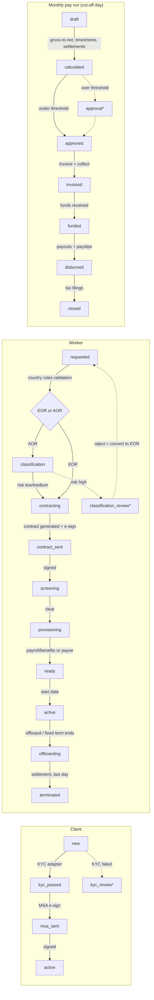

# LanceSoft EOR / AOR Automation Platform

An automated production line for **Employer of Record (EOR)** and **Agent of Record (AOR)** services
for [lancesofteor.com](https://www.lancesofteor.com). Every stage of the lifecycle, from client signup
through worker onboarding, payroll, invoicing, payouts, tax filing and offboarding, runs as a state
machine that advances on its own. People only see the **exceptions** that rules or thresholds send to
an approval queue.

It uses only the Python standard library (3.11 or newer). It needs no pip install, and SQLite is the database.

```bash
python -m eor demo                    # simulate ~10 weeks of operations and print the results
python -m eor serve                   # API + web console + scheduler on http://127.0.0.1:8080
python -m eor quote GB 65000          # employer cost estimate
python -m eor tick --today 2026-01-20 # run one automation pass (e.g. from cron)
python -m unittest discover -s tests -t .
```

Docker: `docker build -t lancesoft-eor . && docker run -p 8080:8080 -v eor-data:/data lancesoft-eor`

## The production line



`*` = human approval task. Everything else is automatic.

| Stage | What is automated |
|---|---|
| Client onboarding | KYC check, MSA generated from commercial terms, sent for e-signature, account activation, welcome email |
| Worker intake | Validation against country rules (supported country, minimum wage, required data), notifies client of problems |
| AOR classification | Weighted misclassification-risk score (control, exclusivity, integration, equipment, duration and more), plus extra risk for strict regimes (UK IR35, DE, MX). High risk is sent to a reviewer, and **rejecting converts the contractor to an EOR employee automatically** |
| Contracts | Employment or contractor agreement generated with country clauses (notice, probation, leave, benefits, right-to-work), then e-signed |
| Screening | Identity, criminal and right-to-work checks. Flagged results go to a reviewer |
| Provisioning | Payroll provider enrolment and benefits (EOR) or payee setup (AOR), plus welcome email |
| Timesheets | Auto-approved within hour/expense thresholds, otherwise reviewed |
| Payroll | Prorated salary, income tax brackets, employee/employer social contributions with floors and caps, statutory bonus accruals (13th month, aguinaldo), contractor fees, expense reimbursements |
| Billing | Invoice in the client's currency (FX), with cost plus EOR per-head fee or AOR percentage fee, collection, and dunning when overdue |
| Disbursement | Worker payouts, payslip emails, statutory tax filing |
| Offboarding | End date defaults to the statutory notice period. Final pay adds unused-leave payout and pay in lieu of notice. Client is told to revoke access and collect equipment. Fixed-term contracts roll into offboarding on their own |
| Audit | Every transition and decision goes to `events`. Every email/SMS goes to `outbox` |

## Architecture

```
eor/
  engine.py      Automator: state machines for clients, workers, timesheets, pay runs; approval gates
  rules.py       Gross-to-net, classification scoring, settlements, quotes (pure functions)
  countries.json Country rule tables (US, GB, CA, IN, DE, PH, MX)
  adapters.py    Integration interfaces + mock providers (KYC, e-sign, background, payroll, payments, FX, notify)
  documents.py   Contract generation
  service.py     Use cases shared by API and CLI (create, update, offboard, timesheets, approvals, webhooks)
  api.py         REST API, web console, background scheduler
  db.py          SQLite store with JSON columns and audit helper
  static/        Operations console (single page, no build step)
```

The scheduler thread calls `Automator.tick()` every `EOR_TICK_SECONDS`. Each tick runs every open record's
handler again and again until nothing moves, so one record can pass through several stages in a single
tick. A record stops only when it is waiting on something outside the system (a signature, a start date,
a payment) or on a person.

### Going live with real providers

Each external system sits behind an interface in `adapters.py`. To connect a real one (DocuSign,
Checkr/Sterling, a local payroll partner, Stripe/Wise/Airwallex, an e-mail relay):

1. Subclass the interface, e.g. `class DocuSignESign(ESignProvider)`.
2. Register it: `REGISTRY["esign"]["docusign"] = DocuSignESign`.
3. Select it with `EOR_ADAPTER_ESIGN=docusign`.
4. Point the provider's webhooks at `POST /api/webhooks/esign` or `/api/webhooks/payments` with
   `{"ref": ..., "status": ...}`. The engine uses pushed status first and falls back to polling.

The mocks can trigger every exception path through the email address: `+kycfail`, `+decline`, `+flag`, `+latepay`.

## API

All endpoints accept and return JSON. Set `EOR_API_KEY` to require an `X-API-Key` header (open the console
with `/?key=...`).

| Method | Path | Purpose |
|---|---|---|
| GET | `/api/dashboard` | Counts by status |
| GET | `/api/countries` | Supported countries |
| POST | `/api/quote` | `{country, salary_annual, engagement_type}` gives the monthly cost breakdown |
| GET/POST | `/api/clients` | List / onboard client `{name, contact_email, billing_currency?, eor_fee_monthly?, aor_fee_pct?, payment_terms_days?}` |
| GET/POST | `/api/workers` | List / request hire `{client_id, full_name, email, country, start_date, engagement_type, salary_annual or rate_hourly, end_date?, job_title?, classification_answers?}` |
| PATCH | `/api/workers/{id}` | Fix data. A worker in `needs_attention` goes back into the line |
| POST | `/api/workers/{id}/offboard` | `{reason, initiated_by: employer\|employee, end_date?}` |
| POST | `/api/timesheets` | `{worker_id, period: YYYY-MM, hours, expenses}` |
| GET | `/api/tasks?status=open` | Approval queue |
| POST | `/api/tasks/{id}/resolve` | `{decision: approve\|reject, note}` |
| GET | `/api/payruns`, `/api/payruns/{id}` | Pay runs with payslips |
| GET | `/api/invoices`, `/api/documents/{id}`, `/api/events`, `/api/outbox` | Billing, contracts, audit, messages |
| POST | `/api/automation/tick` | Run a pass now (`{today?}` for back-dating or simulation) |
| POST | `/api/webhooks/{esign\|payments}` | Provider callbacks |

## Configuration

| Variable | Default | Meaning |
|---|---|---|
| `EOR_DB` | `eor.db` | SQLite path |
| `EOR_HOST` / `EOR_PORT` | `127.0.0.1` / `8080` | Bind address |
| `EOR_API_KEY` | (none) | Require `X-API-Key` |
| `EOR_TICK_SECONDS` | `30` | Automation interval |
| `EOR_OPS_EMAIL` | `ops@lancesofteor.com` | Where approval notifications go |
| `EOR_EOR_FEE_MONTHLY` / `EOR_AOR_FEE_PCT` | `599` / `0.05` | Default client pricing |
| `EOR_PAYROLL_CUTOFF_DAY` | `20` | Day of month pay runs are created |
| `EOR_PAYRUN_APPROVAL_THRESHOLD` | `250000` | Pay runs above this (billing currency) need approval |
| `EOR_TIMESHEET_AUTO_APPROVE_HOURS` / `EOR_EXPENSE_AUTO_APPROVE` | `200` / `1000` | Timesheet auto-approval limits |
| `EOR_ADAPTER_<NAME>` | `mock` | Provider for `kyc`, `esign`, `background`, `payroll`, `payments`, `fx` |

## Before production

- **Statutory data.** `countries.json` is a simplified national-level model (annualised brackets, no
  state/provincial tax, no allowances or credits). Each country needs sign-off from in-country payroll
  or legal partners, and the real payroll provider should be the system of record for withholding.
- **Real adapters.** Every provider is a mock today.
- **Security.** Add SSO or role-based access in place of the single API key, put TLS in front, and
  encrypt PII (bank details, national IDs) at rest.
- **Scale.** SQLite with a single process suits a pilot. For multi-instance deployment, move `db.py` to
  Postgres and run `tick` from a single scheduler.
